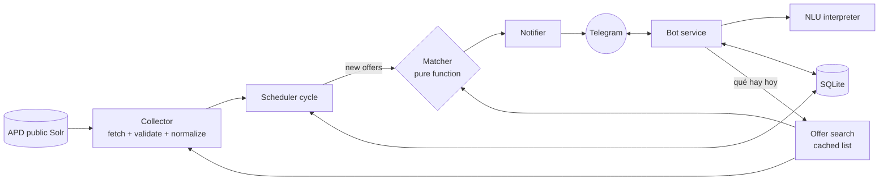

# Alertas APD

[](https://github.com/pmorrone/alertas-docentes/actions/workflows/ci.yml)

A Telegram bot that tells Buenos Aires province teachers, mostly substitutes, as soon as a job offer matching what they are looking for is published on **APD** (_Actos Públicos Digitales_, the DGCyE's public hiring site).

Teachers do not fill in forms. They write to the bot the way they would talk, and it works out the rest:

```
Teacher  historia en pilar a la tarde
Bot      Voy a avisarte de ofertas de:
         Historia · Pilar · Tarde
         ¿Confirmás?            [✅ Sí] [✏️ Cambiar]
```

Later, when a matching offer appears:

```
🆕 Maestro de Danza Primaria (MDP), Artistica, Pilar
2°B · Turno T · Suplencia del 26/10 al 24/11 · Hs/módulos: 2
Vie 15 A 17
📍 Pasteur y Tucuman (0083PP0032)
⏰ Cierra: 13/11 07:30
🔔 Tu alerta: Danza · Pilar · Tarde                 [🔗 Ver en ABC]
```

> The bot speaks Spanish because its users do. Code, comments and docs are in English.

## What it does

- **Alerts in plain language.** "suplencias de inglés turno mañana en tandil" becomes a district, a subject, a shift and a substitute-only filter. It tolerates typos ("matematika en tandill"), nicknames ("mardel") and spoken-style sentences.
- **It asks instead of guessing.** If a subject is ambiguous ("ciencias") or something is missing (no district), it asks with buttons. Nothing is saved until the teacher confirms.
- **Several alerts per teacher** (3 by default), each one paused or deleted on its own. A teacher gets one notice per offer even when two of their alerts match.
- **"¿Qué hay hoy en Tandil?"** shows what is published right now, and one tap turns that search into an alert.
- **Private by design.** The API exposes names and ID numbers of teachers and authors; they are discarded when an offer is parsed and never stored, logged or shown.

## How it works



Every cycle (20 minutes by default) the scheduler fetches all published offers, keeps the ones it has not seen, and sends each active teacher the offers that match one of their alerts.

| Folder            | Responsibility                                                                |
| ----------------- | ----------------------------------------------------------------------------- |
| `src/collector/`  | Solr client and normalization (raw doc → `Offer`, personal data dropped)      |
| `src/matcher/`    | `matches(offer, criteria)`: a pure function, no I/O                           |
| `src/nlu/`        | Rule-based interpreter: text → intent, criteria, or a question                |
| `src/bot/`        | `BotService` (all the conversation logic) and the thin grammY adapter         |
| `src/notifier/`   | Offer formatting and delivery through Telegram                                |
| `src/search/`     | "What is there right now", on a cached list                                   |
| `src/db/`         | Repository interfaces, SQLite implementation and versioned migrations         |
| `src/scheduler.ts`| One cycle: collect → keep new → match → notify                                |

## Design decisions

**The data source is unofficial, so the client is careful.** There is no documented API, only the public Solr behind the website. The collector polls at most every 5 minutes (20 by default), sends an identifiable `User-Agent`, uses timeouts, retries with exponential backoff, and validates every document with zod. A document that no longer fits is skipped and counted instead of breaking the whole run.

**Two surprises in the data, both found by looking at it.**
The API sends **Windows-1252 without declaring it**, so reading it as UTF-8 turns `2°B` into `2�B`; the client decodes the raw bytes. And its timestamps are labeled `Z`, but they are **Argentina wall-clock times**: offers close at 07:30 or 10:30 (as real UTC that would be 04:30), so notices show the digits as they come.

**Personal data is dropped by construction.** The zod schema only declares the fields the bot needs, and zod strips everything else, so author, replaced teacher and winner fields cannot reach an `Offer`. Tests feed those fields with distinctive values and assert they appear nowhere in the output or in validation errors.

**One matcher for everything.** Alerts and "what is there right now" use the same pure function, so they always agree. It is small enough to test exhaustively, and the search filters in memory rather than in Solr to avoid mismatches such as `canuelas` vs `cañuelas`.

**A rule-based interpreter instead of an LLM.** For this domain the vocabulary is closed (135 districts, 11 levels, ~1,100 areas), so the interpreter uses the real catalogs, an editable synonyms file (`data/sinonimos.json`) and Levenshtein distance for typos. It costs nothing, is deterministic, works offline and is tested with real phrases. When it is unsure it returns a question, and that question carries its own state as plain data, so the bot keeps no bookkeeping. An LLM can sit behind an interface later as a fallback.

**Delivery you can reason about.** The first cycle records the existing offers silently, so nobody is flooded on day one. A `(teacher, offer)` pair is never notified twice. An offer counts as seen only after every matching teacher was served, so a transient Telegram failure is retried next cycle without duplicating notices; a blocked bot pauses that teacher instead of retrying forever. A crash between sending and recording can repeat one notice (at-least-once), which is documented and accepted.

**Ready to change storage.** Repositories are async interfaces over SQLite (WAL, versioned migrations), so moving to Postgres does not touch the callers. The bot logic knows nothing about Telegram, which is why most of it is tested with plain strings.

## Getting started

Requires Node.js 22 or newer.

```bash
npm ci
cp .env.example .env     # set TELEGRAM_BOT_TOKEN (create a bot with @BotFather)
npm run dev
```

Without a token the app still runs and only logs the alerts it would send.

| Variable              | Default                | Meaning                                                  |
| --------------------- | ---------------------- | -------------------------------------------------------- |
| `TELEGRAM_BOT_TOKEN`  | none                   | Bot token. Never commit it: `.env` is git-ignored        |
| `POLL_INTERVAL_MIN`   | `20`                   | Minutes between collections (minimum 5)                  |
| `DB_PATH`             | `./data/alertas.sqlite`| SQLite file                                              |
| `MAX_ALERTS_PER_USER` | `3`                    | Alerts each teacher can have                             |

To look at the data without running the bot:

```bash
npm run collect:once -- --district "general pueyrredon"
```

### Docker

```bash
docker compose up -d --build
```

The database lives in a named volume (`/var/lib/alertas`), so it survives rebuilds. The container runs as a non-root user and stops cleanly on `SIGTERM`.

## Development

| Script                              | What it does                                |
| ----------------------------------- | ------------------------------------------- |
| `npm test`                          | All tests (no network)                      |
| `npm run lint` / `npm run typecheck`| ESLint and `tsc --noEmit`                   |
| `npm run format:check`              | Prettier                                    |
| `npm run build`                     | Compile to `dist/`                          |

There are 250+ tests. HTTP is replaced with a fake `fetch` and Telegram with a fake API behind grammY, so the suite needs no network or token. CI runs formatting, lint, types, tests and build on every pull request, and builds and smoke-tests the Docker image.

## Status

Working: collector, matcher, scheduler, multiple alerts, Telegram bot, current-offers search, Docker and CI.

Next:

- Voice notes (local `whisper.cpp` behind a `Transcriber` interface).
- Invitation codes and a user cap for a small pilot.
- Notices when an offer that was announced changes state, and availability schedules.

Known limitations: there is no send-rate control yet (Telegram allows about 30 messages per second overall and 1 per second per chat; a rate-limit error is retried next cycle), and the scheduler's "already closed" check treats `closesAt` as a real instant, so it may consider an offer closed a few hours early.

## About the data

This is an independent project, not affiliated with the DGCyE. It only reads public data, at low frequency, from the same endpoints the official website uses.
